# VeloForge

[](https://github.com/hmaltawil/veloforge-1/actions/workflows/ci.yml)

A free, local indoor-cycling app for Linux, Windows and macOS: smart trainer control, structured workouts, training plans and a 3D world to ride in. Everything runs on your computer, with no account and no subscription.

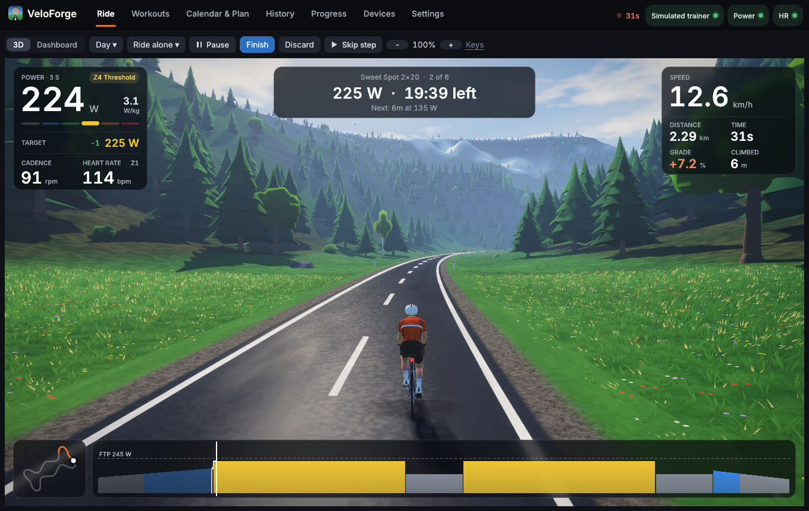

## What it does

- **Controls your smart trainer** over Bluetooth. ERG mode holds a target power, and simulation mode makes the resistance follow the road. It works with trainers that use the standard FTMS protocol, and with older Wahoo KICKR / SNAP firmware through Wahoo's legacy protocol.
- **Structured workouts**: about 30 built in (recovery, endurance, tempo, sweet spot, threshold, VO2 max, sprints, ramp test, 20-minute test), a visual builder for your own (drag blocks to set their power and length, or to move them, with undo), import of `.zwo` files from intervals.icu, TrainerRoad, WhatsOnZwift and others, and export of any workout as a `.zwo` file for other apps. Steps can have a cadence target, shown next to your live cadence (green when you're within 5 rpm).
- **Training plans and a calendar**. VeloForge generates a periodized plan (FTP builder, aerobic base or maintenance) on the days you ride: three build weeks, then a recovery week. Missed a key workout? It offers to move it to your next free day. Tired? It suggests an easier ride instead.
- **Heart-rate rides**: pick a target heart rate and VeloForge sets the trainer's power to hold it.
- **Ride with someone**: a pacer at a power you choose, or a ghost of your own best ride on the same route. Tuck in close behind and you **draft**: up to a third less air to push, so you go faster and the trainer gets easier.
- **3D world** rendered on your graphics card: farmland, lakes, snowy mountains, an island coast road and a hairpin climb, by day, at sunset or at night, in sun, cloud, fog or rain. Trees cast shadows across the road, grass and wild flowers bend in the wind, clouds drift and shade the hills, and the low sun glitters on the water. Your rider is sculpted as one body with a real bike fit: they pedal with natural ankle movement, breathe harder as the effort rises, stand up on steep climbs and tuck on fast descents. Watch from behind, close up, alongside or from above (press **C**). Every climb is a timed **segment**: VeloForge finds them on each route (imported ones too), shows your time and your best as you ride, cheers a new personal record, and keeps a table of your records. Make a **random route** whenever you like (choose the scenery, length, how hilly and whether it is a loop; each has its own bends, climbs and name), or import any `.gpx` file to ride a real route (**Settings → Routes → Import a GPX route…**). A route that ends away from its start, like a climb to a summit, is ridden **point to point**: it finishes at the top, and if your workout is still going the road carries on beyond the finish. The land reaches to the mountains on the horizon. A ride **finishes by itself** when its workout is done (press **Keep riding** to cool down first). A **dashboard** view shows the numbers instead (press **V**).
- **Metric or imperial**: km/h, km, metres and kg, or mph, miles, feet and pounds, everywhere in the app.
- **Phone remote**: your phone shows the live numbers, the interval, the climb and drafting, and starts, pauses, skips steps, changes the intensity, the view or the camera, over your home Wi-Fi.
- **intervals.icu**: the rides you plan there appear in your calendar, and finished rides upload by themselves.
- **Strava**: finished rides upload by themselves, as indoor rides (connect once in **Settings → Strava**, through your own free Strava API application; VeloForge shows you how).
- **Progress**: fitness, fatigue and form, weekly hours, your power curve, FTP history and monthly totals.
- **Heart rate, power and cadence sensors**, with heart rate zones from your max or your threshold heart rate (the 20-minute FTP test measures it), and noise detection that ignores a strap reading nonsense.
- **Audio cues**: a 3-2-1 countdown before interval changes, a chime at the end, and a warning if the trainer disconnects.
- **Your rides**: every ride is saved as a `.fit` and a `.tcx` file for Strava, Garmin Connect, intervals.icu, TrainingPeaks or GoldenCheetah, with a lap for each workout interval so every effort shows up on its own. History shows charts, time in zones and best efforts. A ride survives crashes and power cuts and is recovered on the next start.

| | |
|---|---|
| 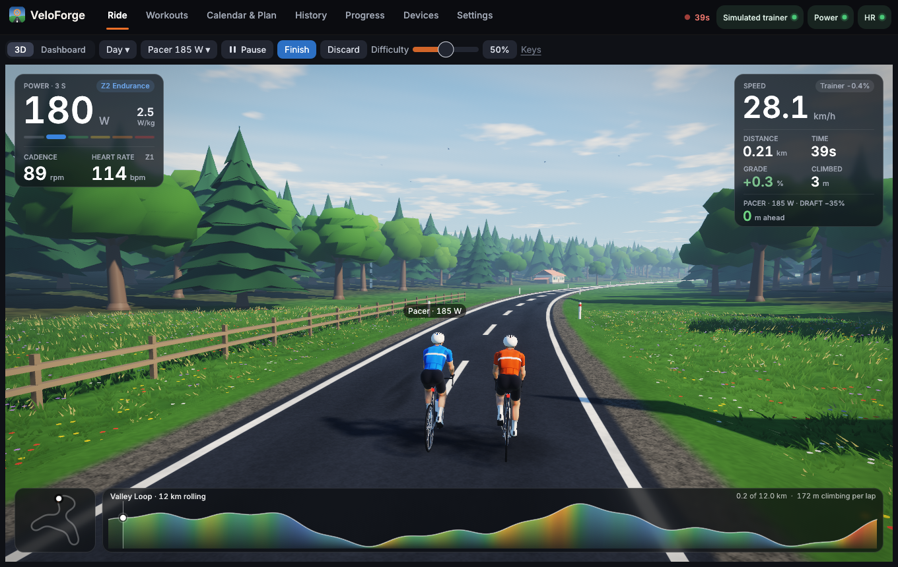<br>Drafting behind a pacer | 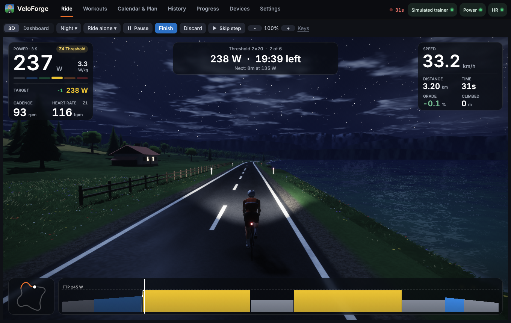<br>A threshold workout at night |
| 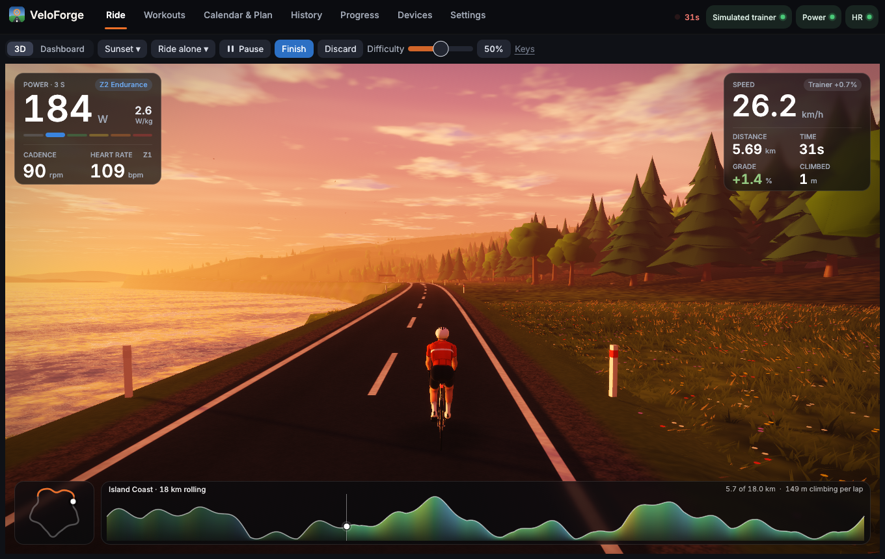<br>The Island Coast at sunset | 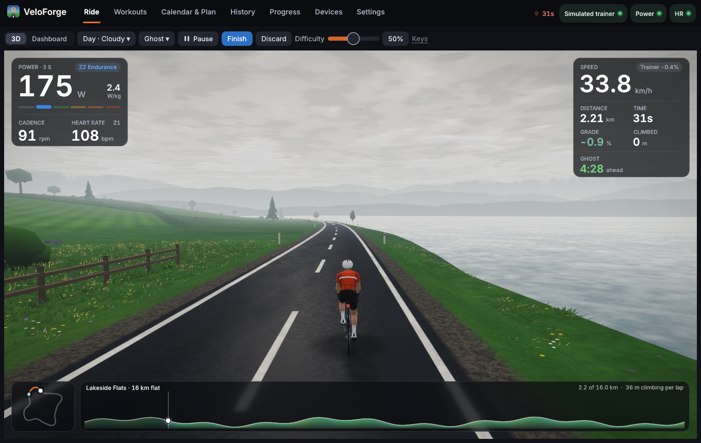<br>Racing your ghost on a cloudy day |
| 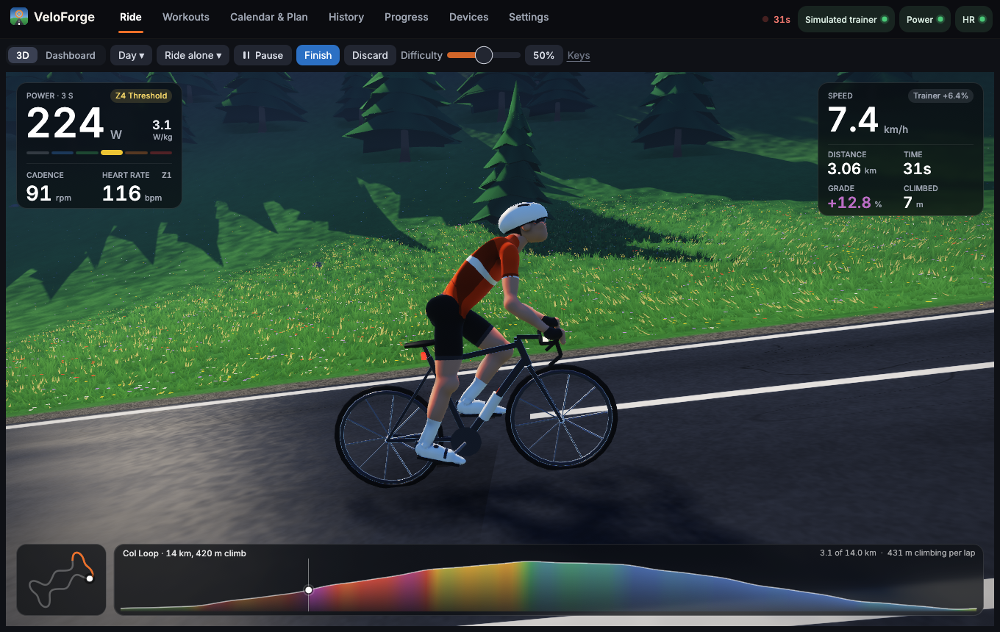<br>Side view on a 13% climb | 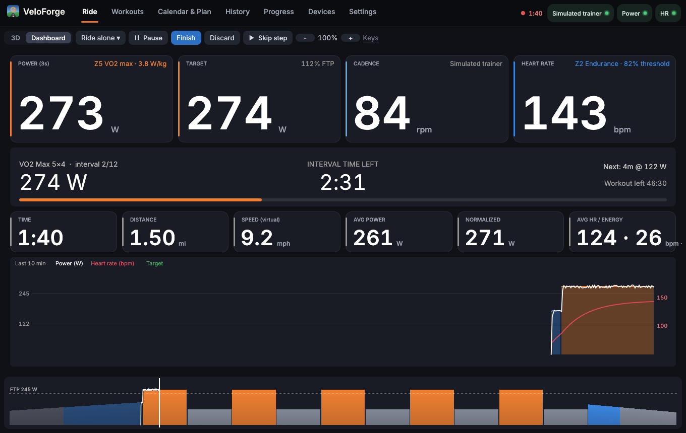<br>The dashboard, in imperial units |
| 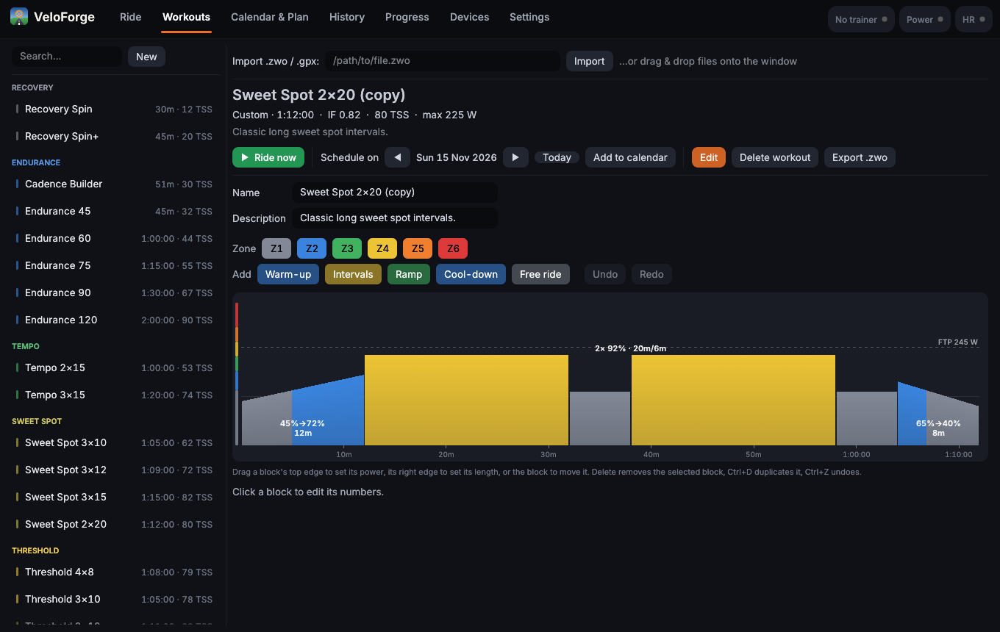<br>The workout builder | 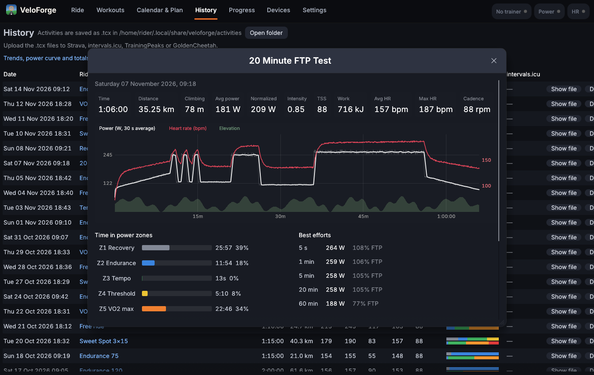<br>Ride details: a 20-minute FTP test |
| 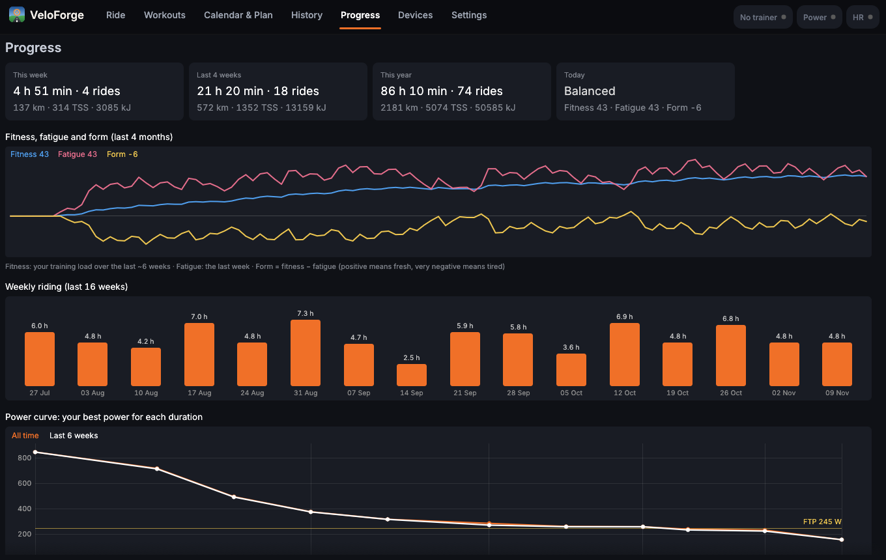<br>Fitness, weekly hours and power curve | 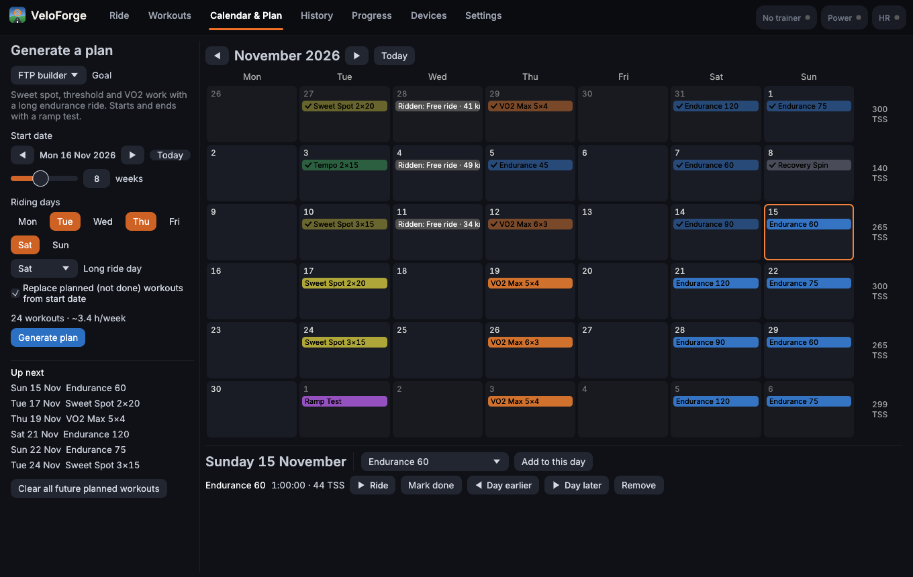<br>A training plan in the calendar |

## Install

Download VeloForge from the [Releases page](https://github.com/hmaltawil/veloforge-1/releases/latest):

- **Ubuntu, Debian, Linux Mint, Pop!_OS:** the `.deb` file. Open it to install, or run `sudo apt install ./veloforge_*_amd64.deb` in the download folder.
- **Other Linux (Fedora, Arch, openSUSE…):** the `linux-x64.tar.gz` file. Unpack it and run `./install.sh` in the `VeloForge` folder; it installs for your user, with an app-menu entry and icon. `./install.sh --uninstall` removes it again.
- **Windows:** the `windows-x64.zip` file (see [Windows](#windows-test-version) below).
- **macOS 11 or newer (Apple Silicon and Intel):** the `macos.dmg` file (see [macOS](#macos-test-version) below).

The Linux downloads need Ubuntu 22.04, Debian 12, Fedora 36 or newer. VeloForge tells you when a new version is out. **To update**, install the new version the same way; your settings, calendar and rides are kept. If you installed the `.tar.gz`, one command does it: `veloforge-update` downloads the newest release, checks it against `SHA256SUMS` and installs it.

### Build it yourself

You need Rust (https://rustup.rs, or your distribution's `rust` and `cargo` packages) and the D-Bus headers that Bluetooth support needs:

```bash
# Fedora
sudo dnf install gcc pkgconf-pkg-config dbus-devel rust cargo
```

```bash
# Debian / Ubuntu / Mint / Pop!_OS
sudo apt install build-essential pkg-config libdbus-1-dev cargo
```

```bash
# Arch / Manjaro
sudo pacman -S base-devel pkgconf dbus rust
```

Then download VeloForge, build it and install it for your user, with an app-menu entry and icon:

```bash
git clone https://github.com/hmaltawil/veloforge-1.git veloforge
cd veloforge
./install.sh
```

**To update:** `git pull && ./install.sh`. Your settings, calendar and rides are kept. `./install.sh --uninstall` removes VeloForge (not your rides).

Try it without any hardware:

```bash
veloforge --demo             # free ride with the simulated trainer
veloforge --demo --workout   # a sweet spot workout, starting just before the first interval
veloforge --demo --workout cadence-builder   # any workout by its id
veloforge --demo --pacer     # free ride alongside a pacer
```

Rides with the simulated trainer (also under **Devices**) are practice: they are not saved to History or Progress, uploaded, or counted for segment records.

### Windows (test version)

VeloForge also runs on Windows 10 and 11 (64-bit). This version is new: the app, 3D world, workouts, sounds and phone remote work, but connecting to trainers and heart rate straps over Bluetooth has not yet been tested on Windows. Reports are welcome.

- **Run it:** download the `windows-x64.zip` file from the [Releases page](https://github.com/hmaltawil/veloforge-1/releases), unzip it and double-click `veloforge.exe`. Windows may warn that it "protected your PC" because the program is new and unsigned; click **More info**, then **Run anyway**. To try it without a trainer, run `veloforge.exe --demo --workout` from a terminal in that folder.
- **Build it yourself:** install Rust from https://rustup.rs, then run `cargo build --release` in the downloaded folder. The program is `target\release\veloforge.exe`.
- **Phone remote:** when Windows Firewall asks, allow VeloForge on private networks.

### macOS (test version)

VeloForge runs on macOS 11 Big Sur or newer, on Apple Silicon and Intel Macs (one universal app). This version is new and has not been tried on a real Mac with a trainer yet. Reports are welcome.

- **Install:** download the `macos.dmg` file from the [Releases page](https://github.com/hmaltawil/veloforge-1/releases), open it and drag VeloForge onto Applications.
- **First start:** the app is not signed with an Apple developer certificate, so macOS stops it the first time. Open **System Settings → Privacy & Security**, scroll to the message about VeloForge and click **Open Anyway**. Or run `xattr -dr com.apple.quarantine /Applications/VeloForge.app` in Terminal.
- **Bluetooth:** allow it when macOS asks; it can be changed later in **System Settings → Privacy & Security → Bluetooth**.
- **Build it yourself:** install Rust from https://rustup.rs and the Xcode command-line tools (`xcode-select --install`), then run `cargo build --release`. `packaging/macos/package.sh` builds the `.app` and `.dmg`.

## Getting started

1. On first start, choose metric or imperial units and enter your **FTP**, weight and **max heart rate**. If you don't know your FTP, start with 2.5 × your weight in kg and ride the **Ramp Test**.
2. Open **Devices**, pedal to wake your trainer, click **Scan**, then **Connect** next to it. Do the same for a heart rate strap. VeloForge remembers your devices and reconnects them automatically.
3. Go to **Ride**, choose **Workout**, **Free ride**, **Slope** or **Heart rate**, and press **Start** (or Space).
4. Press **Finish** when you're done. The ride goes to History and ticks off the planned workout in your calendar.

### Riding

| Mode | What happens |
|---|---|
| **Workout** | The trainer holds each step's target power. **+/−** (or ↑/↓) changes the intensity by 5%, **Skip step** (or N) moves on. "Free ride" steps hand control back to you. |
| **Free ride** | Resistance follows the road. **Trainer difficulty** sets how much of the real gradient you feel (50% by default). |
| **Slope** | A fixed gradient of your choice (↑/↓ changes it). |
| **Heart rate** | Choose a target heart rate (↑/↓ changes it by 2 bpm). The trainer's power is adjusted gently every few seconds to hold it. If the strap drops out, the power stays where it was. |

Shortcuts: **Space** start/pause, **↑/↓** intensity / slope / difficulty / target heart rate, **N** skip step, **V** 3D view ↔ dashboard, **C** camera. By default the clock pauses automatically when you stop pedalling.

**Ride with**: the menu next to the route lets you ride alone, with a **pacer** holding a steady power (with the same weight and bike as you), or against a **ghost**: a replay of one of your earlier rides on the same route, fastest first. The gap shows in metres (pacer) or seconds (ghost). Riding a few metres behind either one saves effort, as on the road: the dashboard shows **DRAFT** and how much you save (switch it off in **Settings → Riding**).

**Time of day and weather**: the menu next to *3D* sets day, sunset or night (with stars, a moon and a bike light) and clear, cloudy, fog or rain. The same choices are in **Settings → Display**.

**On screen while you ride**: your power with its zone, target, cadence and heart rate on the left; speed, distance, time, gradient and climbing on the right; a map of the route and its profile, coloured by gradient, along the bottom. Once you start, the choice of workout and route makes way for the controls you need on the bike.

**Units**: metric or imperial, chosen on the welcome screen or in **Settings → Riding**. Everything is stored in metric, so you can switch at any time.

**Workouts on a route**: the trainer holds each step's power whatever the road does, while your speed still follows the hills. Tick **Settings → Riding → Ride workouts on the flat** to have speed, distance and climbing ignore the hills too, so rides of the same workout compare. A finished workout's chart shows its target steps behind your power.

**Speed** comes from your trainer's wheel speed when it reports one, or is calculated from your power, weight and the gradient. Choose which in **Settings → Riding**.

### Workouts and plans

- **Workouts**: browse the library, see each workout's profile and training stress, click **Ride now**, or **Add to calendar**. Use **New** or **Copy to custom** to build your own.
- **Calendar & Plan**: pick a goal, a start date, the number of weeks and your riding days, then **Generate plan**. Click any day to ride, move, tick off or remove a workout.
- **Missed and tired**: when you miss a planned workout, the calendar offers to move it to your next free day or skip it. When your form (Progress tab) shows you're very tired, the Ride screen suggests an easier ride for today.
- **intervals.icu**: in **Settings → intervals.icu**, enter your athlete ID and API key (on intervals.icu: Settings → Developer Settings). Rides you plan on intervals.icu for the next four weeks appear in the calendar, and finished rides are uploaded automatically (or with **Upload** in History).
- **Other sources**: download a workout as **Zwift (.zwo)** and drag the file onto the VeloForge window.

### Phone remote

Turn it on in **Settings → Phone remote** and scan the QR code with your phone's camera (the phone must be on the same Wi-Fi). The page shows power, heart rate, target or speed, cadence, gradient and distance, the current interval, the climb you're on (with your best time) and how much you save drafting, and has big buttons to start, pause, skip a step, change the intensity, switch between the 3D view and the dashboard, change the camera and finish the ride. Messages from the app, such as "Ride saved", appear on the phone too. The link contains an access code, so other devices on your network can't control your ride; **New code** makes a new link.

If the phone can't connect, allow the port in the firewall:

```bash
sudo firewall-cmd --add-port=8642/tcp --permanent && sudo firewall-cmd --reload
```

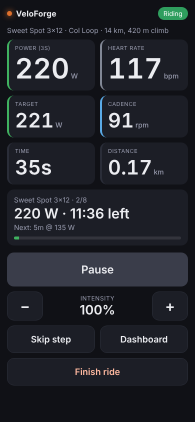

### Calibration

Wheel-on trainers such as the KICKR SNAP read power more accurately after a **spindown**. Go to **Devices → Calibrate** next to your trainer, after about 10 minutes of riding so the tyre is warm. Trainers on older Wahoo firmware can only be calibrated in the Wahoo app; the result is stored in the trainer and applies in VeloForge too.

## Troubleshooting

- **Bluetooth unavailable**: `sudo systemctl enable --now bluetooth`, then `bluetoothctl power on`.
- **Scan finds nothing**: pedal to wake the trainer, and close the Wahoo app or Zwift on your phone, since a trainer accepts only one controlling app. If a device connects but shows no data, remove ("forget") it in your system's Bluetooth settings and connect again from VeloForge.
- **Heart rate is hidden or looks wrong**: check the strap's card in **Devices**. It shows skin contact and warns when the strap is measuring noise. Wet the electrodes, wear it snug, and replace its battery (CR2032) if it's old.
- **No sound**: install a player with `sudo dnf install pipewire-utils`, then test in **Settings → Sound**.
- **3D view is slow, or the graphics card runs hot**: set **Settings → Display → Frame rate** to *30 fps* (smooth enough for riding, and half the work), and/or lower **Settings → Display → Detail** or **Resolution**. *Medium* detail halves the shadow sharpness, grass and edge smoothing; *Low* drops shadows and grass, for older graphics cards. *Resolution* draws the world at 75% or 50% and enlarges it with a sharpening filter (the numbers and panels stay sharp); on *Automatic* it is full on High and Medium and two thirds on Low.
- **Laptop with two graphics chips**: started from the app menu, VeloForge asks GNOME or KDE for the dedicated one. **Devices → Log** shows which one it got ("Graphics: …"). From a terminal, start it with `__NV_PRIME_RENDER_OFFLOAD=1 __GLX_VENDOR_LIBRARY_NAME=nvidia veloforge` (NVIDIA driver) or `DRI_PRIME=1 veloforge` (AMD and other cards).
- **How fast does the 3D view draw?** Run `veloforge --bench` (with the same graphics settings as usual). It rides the Valley Loop for a minute, then prints the frame rate and how long the graphics card spends on shadows, the scene (split into trees and objects, ground and road, grass, and the rest) and the finishing pass, and how busy it would be at 30 and 60 fps. The result is also saved as `bench.txt` next to your rides. Compare runs before and after changing **Detail** or **Resolution**.
- **3D view looks wrong**: choose **Settings → Display → Simple**, or try `VELOFORGE_POST=0 veloforge`, which draws the world without the finishing pass (no glow, light shafts, frosted panels or smoothed edges). If the window doesn't open at all, run `VELOFORGE_GL=1 veloforge` (simple view).
- **Something else**: **Devices → Open full log** shows everything VeloForge did. Tick **Log raw sensor data** to record exactly what your devices send.

## Your data

Everything stays on your computer in `~/.local/share/veloforge/` (on Windows: `%APPDATA%\veloforge\data\`; on macOS: `~/Library/Application Support/veloforge/`):

| File | Contents |
|---|---|
| `state.json` | settings, calendar, history, custom workouts, imported and random routes, FTP history, segment times |
| `credentials.json` | your intervals.icu athlete ID and API key (readable only by you) |
| `strava.json` | your Strava app's ID and secret and the access it was given (readable only by you) |
| `activities/*.fit`, `*.tcx` | your rides |
| `veloforge.log` | the log, for troubleshooting |

Deleting a ride in **History** moves its files to the Trash (the Recycle Bin on Windows), so you can restore it from there. Set `VELOFORGE_DATA=/some/dir` to use a different folder.

**Updates:** when it starts, VeloForge asks GitHub once whether a newer version has been released, and shows **Update** in the top bar if so. The request contains only the app's version, nothing about you or your rides. Turn it off in **Settings → Data & about**.

## For developers

VeloForge is written in Rust with [egui](https://github.com/emilk/egui) for the interface, [btleplug](https://github.com/deviceplug/btleplug) for Bluetooth and OpenGL for the 3D world. Run the tests with `cargo test`.

| File | Purpose |
|---|---|
| `src/protocol.rs` | Bluetooth GATT parsers and encoders: FTMS, cycling power, heart rate, CSC, Wahoo legacy |
| `src/devices.rs` | Bluetooth manager thread: scanning, connecting, reconnecting, trainer commands, simulator |
| `src/ride.rs` | Ride engine: virtual speed, drafting, ERG/gradient decisions, heart-rate control, pacer and ghost, recording, TCX export, summaries |
| `src/fit.rs` | FIT files for saved rides |
| `src/workout.rs` | Workout model, built-in library, `.zwo` import and export, training load, interval cues |
| `src/builder.rs` | The visual workout builder |
| `src/plan.rs` | Plan generator, calendar helpers, missed workouts and easier options |
| `src/progress.rs` | Fitness, fatigue and form, power curves, weekly and monthly totals |
| `src/icu.rs` | intervals.icu client: planned workouts down, rides up |
| `src/strava.rs` | Strava connection and uploads |
| `src/remote.rs` | Phone remote: a small web server on the local network |
| `src/update.rs` | The check for a newer version |
| `src/route.rs` | Built-in routes (including the hairpin climb) and GPX import |
| `src/routegen.rs` | Random routes: bends, hills and names from a seed |
| `src/scenery.rs` | Each scenery's settings in one entry: sky, water, land, fields, fences and walls, what grows, random routes, simple-view colours |
| `src/segment.rs` | Climbs found on each route, timing and personal records |
| `src/activity.rs` | Reading saved rides back (ride details, crash recovery) |
| `src/gfx/` | OpenGL 3D world: terrain generation, meshes, shaders, renderer (shadow maps, HDR, post-processing) |
| `src/gfx/terrain.rs` | The land and road bed, where trees and objects stand, and each kind of object (`OBJECTS`: its group, size and model) |
| `src/gfx/body.rs` | The rider: a sculpted body bent by a skeleton |
| `src/app/hud.rs` | The glass panels over the 3D view |
| `src/theme.rs` | Colours, typefaces (Inter, in `assets/fonts/`) and widget styling |
| `src/world.rs` | Simple software 3D view (fallback), time of day and weather |
| `src/sound.rs` | Audio cues |
| `src/charts.rs` | Charts and zone colours |
| `src/units.rs` | Metric and imperial units |
| `src/platform.rs` | The few differences between Linux, Windows and macOS |
| `src/store.rs` | Saved settings, routes and rides, and where they are kept |
| `build.rs` | Gives the Windows `.exe` its icon, name and version |
| `packaging/linux/` | Builds and tests the Linux `.deb` and `.tar.gz` downloads |
| `packaging/macos/` | Builds and tests the macOS `.app` in a `.dmg` |
| `src/app.rs`, `src/app/` | The user interface: the app's state and frame loop, and a file per screen |
| `src/demo_data.rs` | A made-up season of riding, for the screenshots in `docs/` |
| `tools/model-lab/` | A web page showing the app's own models and scenery, for looking at changes before they go into the app |

**Adding a scenery**: add it to `Scenery` and to `Scenery::ALL` in `src/route.rs` (saved routes name it; the menus and the tests go through `ALL`, and a test fails if it is missing there), and give it an entry in `src/scenery.rs`, which the compiler insists on. **Adding a kind of object**: give it a number and an entry in `OBJECTS` in `src/gfx/terrain.rs`, and place it where trees and objects are placed; the renderer draws it from its entry, and the ground tests say what they need to know about it.

**Screenshots**: the pictures in `docs/` show a made-up rider's season, generated with the app's own ride engine. To make it again:

```bash
VELOFORGE_DEMO_OUT=/tmp/demo cargo test make_demo_data -- --ignored
VELOFORGE_DATA=/tmp/demo cargo run --release -- --demo --workout
```

The interface is set in [Inter](https://rsms.me/inter/), used under the SIL Open Font License (`assets/fonts/LICENSE.txt`).

## License

VeloForge is released under the [MIT License](LICENSE).
