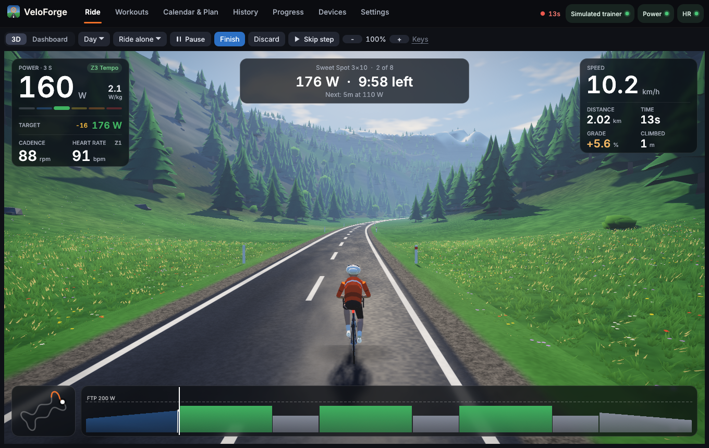
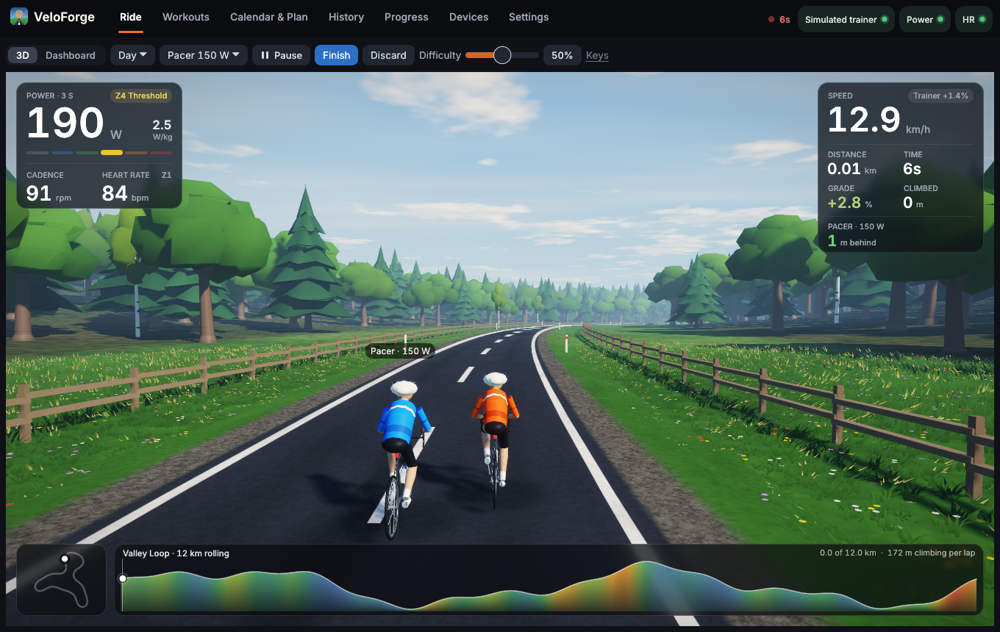
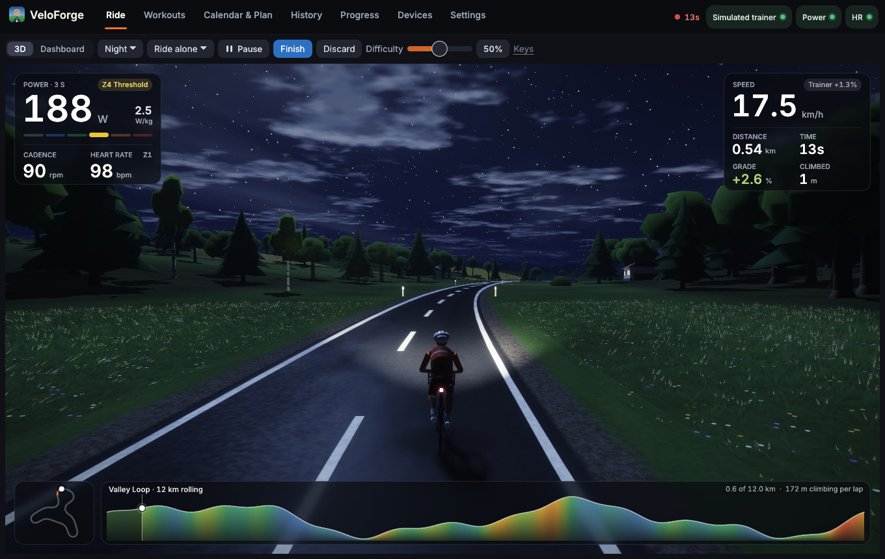
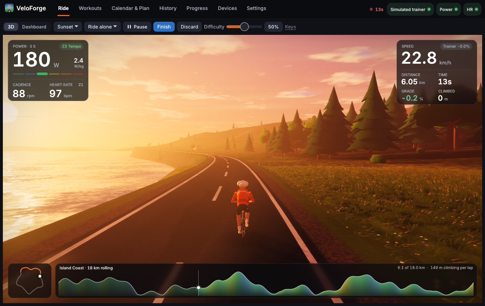
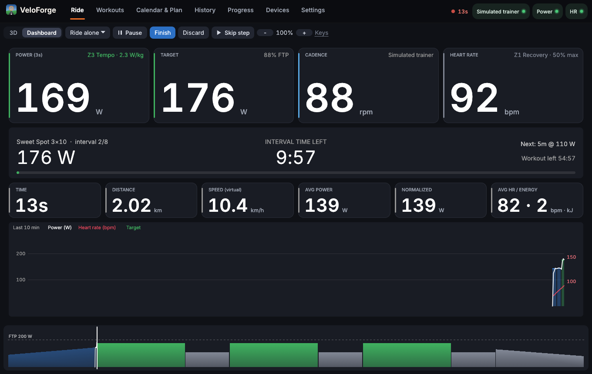
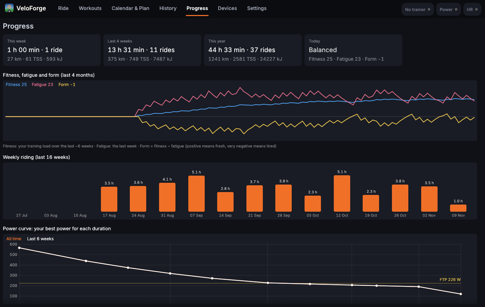
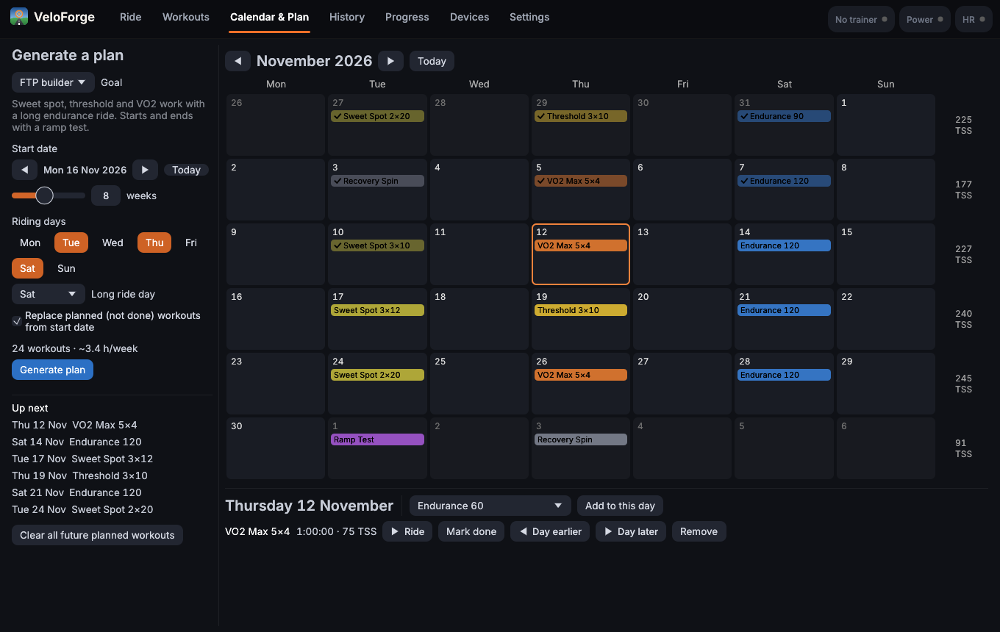
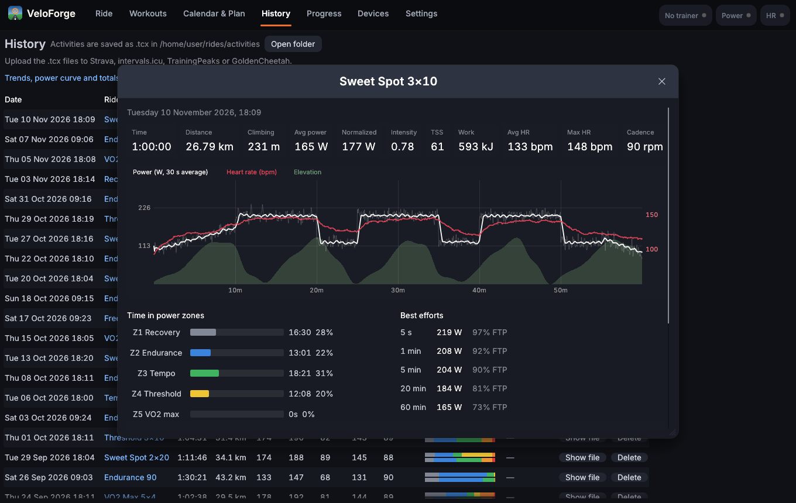
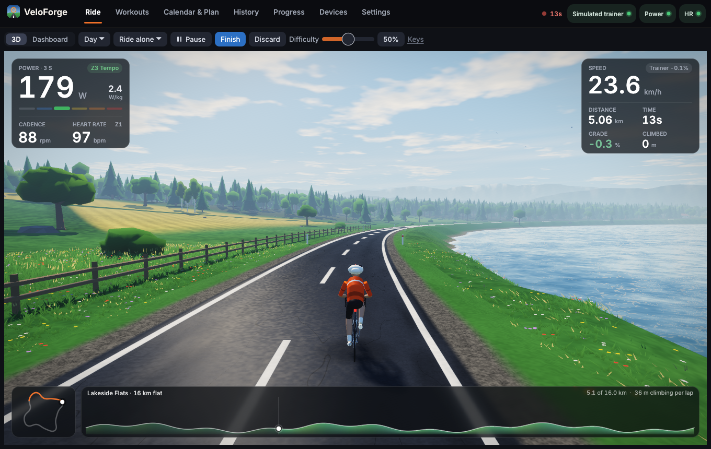
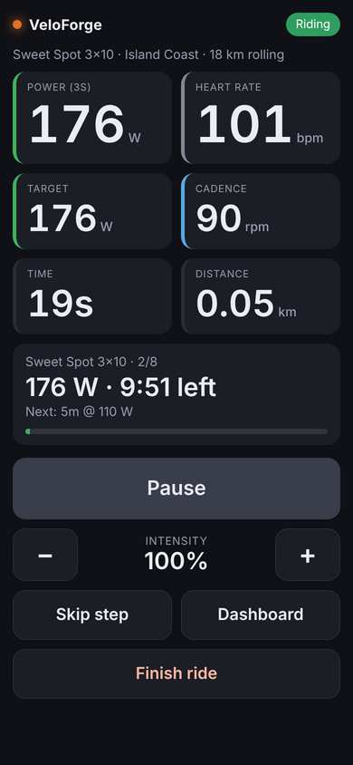

# VeloForge

[](https://github.com/hmaltawil/veloforge-1/actions/workflows/ci.yml)

A free, local indoor-cycling app for Linux, with a Windows version in testing: smart trainer control, structured workouts, training plans and a 3D world to ride in. Everything runs on your computer, with no account and no subscription.



## What it does

- **Controls your smart trainer** over Bluetooth. ERG mode holds a target power, and simulation mode makes the resistance follow the road. It works with trainers that use the standard FTMS protocol, and with older Wahoo KICKR / SNAP firmware through Wahoo's legacy protocol.
- **Structured workouts**: about 30 built in (recovery, endurance, tempo, sweet spot, threshold, VO2 max, sprints, ramp test, 20-minute test), a step editor for your own, and import of `.zwo` files from intervals.icu, TrainerRoad, WhatsOnZwift and others. Steps can have a cadence target, shown next to your live cadence (green when you're within 5 rpm).
- **Training plans and a calendar**. VeloForge generates a periodized plan (FTP builder, aerobic base or maintenance) on the days you ride: three build weeks, then a recovery week. Missed a key workout? It offers to move it to your next free day. Tired? It suggests an easier ride instead.
- **Heart-rate rides**: pick a target heart rate and VeloForge sets the trainer's power to hold it.
- **Ride with someone**: a pacer at a power you choose, or a ghost of your own best ride on the same route.
- **3D world** rendered on your graphics card: farmland, lakes, snowy mountains, an island coast road and a hairpin climb, by day, at sunset or at night, in sun, cloud, fog or rain. Trees cast shadows across the road, grass and wild flowers bend in the wind, clouds drift and shade the hills, and the low sun glitters on the water. Import any `.gpx` file to ride a real route. A **dashboard** view shows the numbers instead (press **V**).
- **Phone remote**: your phone shows the live numbers and starts, pauses, skips steps or changes the intensity, over your home Wi-Fi.
- **intervals.icu**: the rides you plan there appear in your calendar, and finished rides upload by themselves.
- **Progress**: fitness, fatigue and form, weekly hours, your power curve, FTP history and monthly totals.
- **Heart rate, power and cadence sensors**, with heart rate zones, and noise detection that ignores a strap reading nonsense.
- **Audio cues**: a 3-2-1 countdown before interval changes, a chime at the end, and a warning if the trainer disconnects.
- **Your rides**: every ride is saved as a `.tcx` file for Strava, intervals.icu, TrainingPeaks or GoldenCheetah. History shows charts, time in zones and best efforts. A ride survives crashes and power cuts and is recovered on the next start.

| | |
|---|---|
|  |  |
|  |  |
|  |  |
|  |  |

## Install

Download VeloForge from the [Releases page](https://github.com/hmaltawil/veloforge-1/releases/latest):

- **Ubuntu, Debian, Linux Mint, Pop!_OS:** the `.deb` file. Open it to install, or run `sudo apt install ./veloforge_*_amd64.deb` in the download folder.
- **Other Linux (Fedora, Arch, openSUSE…):** the `linux-x64.tar.gz` file. Unpack it and run `./install.sh` in the `VeloForge` folder; it installs for your user, with an app-menu entry and icon. `./install.sh --uninstall` removes it again.
- **Windows:** the `windows-x64.zip` file (see [Windows](#windows-test-version) below).

The Linux downloads need Ubuntu 22.04, Debian 12, Fedora 36 or newer. VeloForge tells you when a new version is out. **To update**, install the new version the same way; your settings, calendar and rides are kept. If you installed the `.tar.gz`, one command does it: `veloforge-update` downloads the newest release, checks it against `SHA256SUMS` and installs it.

### Build it yourself

You need Rust (https://rustup.rs, or your distribution's `rust` and `cargo` packages) and the D-Bus headers that Bluetooth support needs:

```bash
# Fedora
sudo dnf install gcc pkgconf-pkg-config dbus-devel rust cargo
```

```bash
# Debian / Ubuntu / Mint / Pop!_OS
sudo apt install build-essential pkg-config libdbus-1-dev cargo
```

```bash
# Arch / Manjaro
sudo pacman -S base-devel pkgconf dbus rust
```

Then download VeloForge, build it and install it for your user, with an app-menu entry and icon:

```bash
git clone https://github.com/hmaltawil/veloforge-1.git veloforge
cd veloforge
./install.sh
```

**To update:** `git pull && ./install.sh`. Your settings, calendar and rides are kept. `./install.sh --uninstall` removes VeloForge (not your rides).

Try it without any hardware:

```bash
veloforge --demo             # free ride with the simulated trainer
veloforge --demo --workout   # a sweet spot workout, starting just before the first interval
veloforge --demo --workout cadence-builder   # any workout by its id
veloforge --demo --pacer     # free ride alongside a pacer
```

### Windows (test version)

VeloForge also runs on Windows 10 and 11 (64-bit). This version is new: the app, 3D world, workouts, sounds and phone remote work, but connecting to trainers and heart rate straps over Bluetooth has not yet been tested on Windows. Reports are welcome.

- **Run it:** download the `windows-x64.zip` file from the [Releases page](https://github.com/hmaltawil/veloforge-1/releases), unzip it and double-click `veloforge.exe`. Windows may warn that it "protected your PC" because the program is new and unsigned; click **More info**, then **Run anyway**. To try it without a trainer, run `veloforge.exe --demo --workout` from a terminal in that folder.
- **Build it yourself:** install Rust from https://rustup.rs, then run `cargo build --release` in the downloaded folder. The program is `target\release\veloforge.exe`.
- **Phone remote:** when Windows Firewall asks, allow VeloForge on private networks.

## Getting started

1. On first start, enter your **FTP**, weight and **max heart rate**. If you don't know your FTP, start with 2.5 × your weight in kg and ride the **Ramp Test**.
2. Open **Devices**, pedal to wake your trainer, click **Scan**, then **Connect** next to it. Do the same for a heart rate strap. VeloForge remembers your devices and reconnects them automatically.
3. Go to **Ride**, choose **Workout**, **Free ride**, **Slope** or **Heart rate**, and press **Start** (or Space).
4. Press **Finish** when you're done. The ride goes to History and ticks off the planned workout in your calendar.

### Riding

| Mode | What happens |
|---|---|
| **Workout** | The trainer holds each step's target power. **+/−** (or ↑/↓) changes the intensity by 5%, **Skip step** (or N) moves on. "Free ride" steps hand control back to you. |
| **Free ride** | Resistance follows the road. **Trainer difficulty** sets how much of the real gradient you feel (50% by default). |
| **Slope** | A fixed gradient of your choice (↑/↓ changes it). |
| **Heart rate** | Choose a target heart rate (↑/↓ changes it by 2 bpm). The trainer's power is adjusted gently every few seconds to hold it. If the strap drops out, the power stays where it was. |

Shortcuts: **Space** start/pause, **↑/↓** intensity / slope / difficulty / target heart rate, **N** skip step, **V** 3D view ↔ dashboard. By default the clock pauses automatically when you stop pedalling.

**Ride with**: the menu next to the route lets you ride alone, with a **pacer** holding a steady power (with the same weight and bike as you), or against a **ghost**: a replay of one of your earlier rides on the same route, fastest first. The gap shows in metres (pacer) or seconds (ghost).

**Time of day and weather**: the menu next to *3D* sets day, sunset or night (with stars, a moon and a bike light) and clear, cloudy, fog or rain. The same choices are in **Settings → Display**.

**On screen while you ride**: your power with its zone, target, cadence and heart rate on the left; speed, distance, time, gradient and climbing on the right; a map of the route and its profile, coloured by gradient, along the bottom. Once you start, the choice of workout and route makes way for the controls you need on the bike.

**Speed** comes from your trainer's wheel speed when it reports one, or is calculated from your power, weight and the gradient. Choose which in **Settings → Riding**.

### Workouts and plans

- **Workouts**: browse the library, see each workout's profile and training stress, click **Ride now**, or **Add to calendar**. Use **New** or **Copy to custom** to build your own.
- **Calendar & Plan**: pick a goal, a start date, the number of weeks and your riding days, then **Generate plan**. Click any day to ride, move, tick off or remove a workout.
- **Missed and tired**: when you miss a planned workout, the calendar offers to move it to your next free day or skip it. When your form (Progress tab) shows you're very tired, the Ride screen suggests an easier ride for today.
- **intervals.icu**: in **Settings → intervals.icu**, enter your athlete ID and API key (on intervals.icu: Settings → Developer Settings). Rides you plan on intervals.icu for the next four weeks appear in the calendar, and finished rides are uploaded automatically (or with **Upload** in History).
- **Other sources**: download a workout as **Zwift (.zwo)** and drag the file onto the VeloForge window.

### Phone remote

Turn it on in **Settings → Phone remote** and scan the QR code with your phone's camera (the phone must be on the same Wi-Fi). The page shows power, heart rate, the current interval and big buttons to start, pause, skip a step and change the intensity. The link contains an access code, so other devices on your network can't control your ride; **New code** makes a new link.

If the phone can't connect, allow the port in the firewall:

```bash
sudo firewall-cmd --add-port=8642/tcp --permanent && sudo firewall-cmd --reload
```



### Calibration

Wheel-on trainers such as the KICKR SNAP read power more accurately after a **spindown**. Go to **Devices → Calibrate** next to your trainer, after about 10 minutes of riding so the tyre is warm. Trainers on older Wahoo firmware can only be calibrated in the Wahoo app; the result is stored in the trainer and applies in VeloForge too.

## Troubleshooting

- **Bluetooth unavailable**: `sudo systemctl enable --now bluetooth`, then `bluetoothctl power on`.
- **Scan finds nothing**: pedal to wake the trainer, and close the Wahoo app or Zwift on your phone, since a trainer accepts only one controlling app. If a device connects but shows no data, remove ("forget") it in your system's Bluetooth settings and connect again from VeloForge.
- **Heart rate is hidden or looks wrong**: check the strap's card in **Devices**. It shows skin contact and warns when the strap is measuring noise. Wet the electrodes, wear it snug, and replace its battery (CR2032) if it's old.
- **No sound**: install a player with `sudo dnf install pipewire-utils`, then test in **Settings → Sound**.
- **3D view is slow**: lower **Settings → Display → Detail**. *Medium* halves the shadow sharpness, grass and edge smoothing; *Low* drops shadows and grass, for older graphics cards.
- **3D view looks wrong**: choose **Settings → Display → Simple**, or try `VELOFORGE_POST=0 veloforge`, which draws the world without the finishing pass (no glow, light shafts or frosted panels). If the window doesn't open at all, run `VELOFORGE_GL=1 veloforge` (no anti-aliasing) or `VELOFORGE_GL=2 veloforge` (simple view).
- **Something else**: **Devices → Open full log** shows everything VeloForge did. Tick **Log raw sensor data** to record exactly what your devices send.

## Your data

Everything stays on your computer in `~/.local/share/veloforge/` (on Windows: `%APPDATA%\veloforge\data\`):

| File | Contents |
|---|---|
| `state.json` | settings, calendar, history, custom workouts, imported routes, FTP history |
| `credentials.json` | your intervals.icu athlete ID and API key (readable only by you) |
| `activities/*.tcx` | your rides |
| `veloforge.log` | the log, for troubleshooting |

Deleting a ride in **History** moves its `.tcx` file to the Trash (the Recycle Bin on Windows), so you can restore it from there. Set `VELOFORGE_DATA=/some/dir` to use a different folder.

**Updates:** when it starts, VeloForge asks GitHub once whether a newer version has been released, and shows **Update** in the top bar if so. The request contains only the app's version, nothing about you or your rides. Turn it off in **Settings → Data & about**.

## For developers

VeloForge is written in Rust with [egui](https://github.com/emilk/egui) for the interface, [btleplug](https://github.com/deviceplug/btleplug) for Bluetooth and OpenGL for the 3D world. Run the tests with `cargo test`.

| File | Purpose |
|---|---|
| `src/protocol.rs` | Bluetooth GATT parsers and encoders: FTMS, cycling power, heart rate, CSC, Wahoo legacy |
| `src/devices.rs` | Bluetooth manager thread: scanning, connecting, reconnecting, trainer commands, simulator |
| `src/ride.rs` | Ride engine: virtual speed, ERG/gradient decisions, heart-rate control, pacer and ghost, recording, TCX export, summaries |
| `src/workout.rs` | Workout model, built-in library, `.zwo` import, training load, interval cues |
| `src/plan.rs` | Plan generator, calendar helpers, missed workouts and easier options |
| `src/progress.rs` | Fitness, fatigue and form, power curves, weekly and monthly totals |
| `src/icu.rs` | intervals.icu client: planned workouts down, rides up |
| `src/remote.rs` | Phone remote: a small web server on the local network |
| `src/update.rs` | The check for a newer version |
| `src/route.rs` | Built-in routes (including the hairpin climb) and GPX import |
| `src/activity.rs` | Reading saved rides back (ride details, crash recovery) |
| `src/gfx/` | OpenGL 3D world: terrain generation, meshes, shaders, renderer (shadow maps, HDR, post-processing) |
| `src/hud.rs` | The glass panels over the 3D view |
| `src/theme.rs` | Colours, typefaces (Inter, in `assets/fonts/`) and widget styling |
| `src/world.rs` | Simple software 3D view (fallback), time of day and weather |
| `src/sound.rs` | Audio cues |
| `src/charts.rs` | Charts and zone colours |
| `src/platform.rs` | The few differences between Linux and Windows |
| `build.rs` | Gives the Windows `.exe` its icon, name and version |
| `packaging/linux/` | Builds and tests the Linux `.deb` and `.tar.gz` downloads |
| `src/app.rs` | The user interface |

The interface is set in [Inter](https://rsms.me/inter/), used under the SIL Open Font License (`assets/fonts/LICENSE.txt`).

## License

VeloForge is released under the [MIT License](LICENSE).
